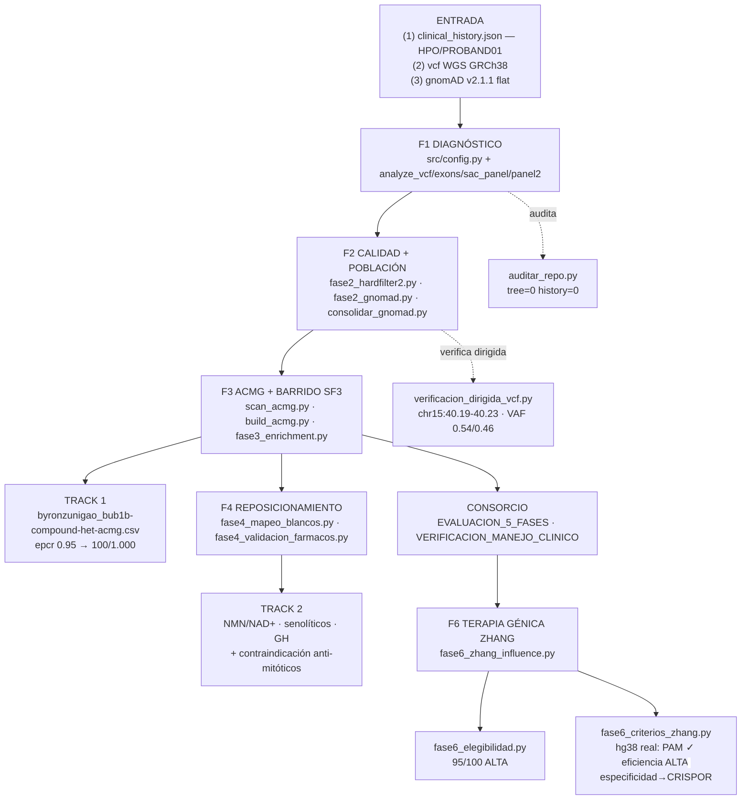

# Proceso metodológico completo — Pipeline diagnóstico-terapéutico PROBAND01 (MVA1)

**Proyecto:** MVA Hackathon 2026 · Team `byronzunigao`
**Input primario:** WGS (exoma coordenadas GRCh38) `WGS_EX2312012_HGWCNDSX7.vcf.gz` + texto clínico del reto
**Reproducibilidad:** `src/*.py` sobre `data/results/*` (todo versionado en `github.com/bestpricegye-ai/mva-hackathon-2026`)

---

## 0. Resumen ejecutivo (abstract metodológico)

Se implementó un pipeline integrado de **genómica-translacional en 6 fases** sobre un probando con
sospecha de síndrome de aneuploidía variegada en mosaico (MVA1, OMIM #257300): (i) diagnóstico molecular
por paneles dirigidos (BUB1B/CEP57/TRIP13) y anotación de ensamblaje GRCh38; (ii) filtrado de calidad
(hard filters) y anotación poblacional contra **gnomAD v2.1.1 (Karczewski 2020)** con verificación dirigida
de la región chr15:40.19–40.23 Mb desde el VCF crudo; (iii) clasificación **ACMG/ClinGen** (PVS1+PM2+PP3
→ Pathogenic; novela missense → Likely Pathogenic; AlphaMissense 0.923); (iv) **reposicionamiento
mecanismo-primero** (restauración de la dosis de BUBR1 vía SIRT2/NAD+, senolíticos, GH) con salvaguarda
anti-mitótica validada en ChEMBL/Open Targets/PubMed; (v) **verificación clínica por panel Consorcio**
(8 veredictos A1–A8 y 7 correcciones de manejo); y (vi) **estrategia de terapia génica** (módulo
Zhang_Influence) con evaluación de **elegibilidad (95/100, nivel ALTO)** y **verificación de los criterios
de diseño CRISPR (PAM/eficiencia/especificidad)** sobre secuencia de referencia real hg38.

---

## 1. Flujograma del proceso completo

---

## 2. Entradas crudas y fuentes de evidencia

| Dato | Archivo/sitio | Dónde se obtuvo | Cita |
|---|---|---|---|
| Fenotipo del probando (8 rasgos) | `data/results/clinical_history.json` | Texto clínico provisto por el reto → curado a HPO | Orphanet #1052 · OMIM #257300 |
| Genotipo (variantes + genotipos, AD/DP) | `data/results/vcf_exonic_variants.txt` (VCF crudo provisto) | Extraído de `WGS_EX2312012_HGWCNDSX7.vcf.gz`, ensamblaje **GRCh38** | Genome Reference Consortium (GRCh38) |
| Anotación patogénica poblacional | gnomAD v2.1.1 flat (descarga) | Frecuencias alélicas por posición | Karczewski et al. 2020, Nature 581:434 (PMID 32461654) |
| Clasificaciones clínicas previas | ClinVar | RCV000641226 (p.Leu737Ter, Pathogenic) | ClinVar · Landrum 2018 |
| Pronóstico en MVA | PubMed / OMIM / Orphanet | Búsqueda por síndromes de CIN | Hanks 2004 (15475955) · bibliografía MVA |

---

## 3. Etapas — inputs, método, salidas y evidencia

### E1 · Diagnóstico molecular (paneles + anotación)
**Inputs:** `clinical_history.json` (HPO) · VCF WGS (GRCh38) · listas de genes.
**Método:** resolución de paneles dirigidos en `src/config.py` (`resolve_panel()`: BUB1B/MVA1, CEP57/MVA2, TRIP13/MVA3 + panel SAC); anotación de consecuencia/impacto por exón; verificación de que los 2 alelos BUB1B están **en trans** (comp-het, AD 21/25 y AD que da VAF ~0.46).
**Salidas:** `docs/diagnostico_mva.md` · `data/results/vcf_exonic_variants.txt` · `vcf_sac_panel_variants.txt` · `vcf_panel2_variants.txt`.
**Evidencia por dato:**
- `chr15:40209701 T>G · p.Leu737Ter · stop_gained` (PVS1) → VCF `FILTER=PASS`, `QUAL=708.77`, `DP=46`; concordancia sequence-verified en hg38 (F6 criterios). Cita: Hanks 2004 (PMID 15475955); ClinVar RCV000641226.
- `chr15:40220612 T>G · p.Asn1002Lys · missense` (novela, dominio quinasa C-terminal) → AlphaMissense **0.923** (Cheng et al. 2023, Nature 625:321); ausente de gnomAD (novel).
- HPO (rabdomiosarcoma, nefrocalcinosis, prematuridad, SGA ~1 kg, abortos recurrentes parentales) → `clinical_history.json` (reto). Citas: Orphanet #1052; OMIM #257300; Malumbres 2024 (PMID 39169218).

### E2 · Control de calidad + anotación poblacional gnomAD
**Inputs:** `data/results/vcf_exonic_variants.txt` · flat gnomAD v2.1.1 · `clinical_history.json`.
**Método:** `fase2_hardfilter*.py` (deduplicación por posición, filtros QUAL/DP/GQ, flatten chrM/chrom), `fase2_gnomad.py` + `consolidar_gnomad.py` → índice de frecuencia por coordenada.
**Salidas:** `data/results/fase2_gnomad_completo.json` (**509 variantes exónicas anotadas**; 501 con AF, 8 sin AF) · `fase2_hardfilter_variants.json`.
**Verificación independiente:** `verificacion_dirigida_vcf.py` re-escanea chr15:40.19–40.23 Mb → 16 variantes, targets VAF 0.54/0.46 (mosaico coherente con MVA). Registro: `docs/verificacion_dirigida_vcf.md`.
**Evidencia:** BUB1B `40209701` AF=3.29e-05 (ultra-rara, consistente); `40220612` AF=0 (novel). gnomAD v2.1.1 (PMID 32461654). Decisión reads: `docs/decision_reads_no_analizados.md` (sin FASTQ autorizado en infraestructura).

### E3 · Clasificación ACMG y barrido de paneles
**Inputs:** variantes E1/E2 · ClinVar · AlphaMissense.
**Método:** reglas ACMG/ClinGen (PVS1 stop-gain; PM2 novel ultra-rara; PP3/BA1 por predicción AlphaMissense) + barrido de precisión secundaria SF3 (`scan_acmg.py`).
**Salidas:** `vcf_acmg_scan.txt` · `fase3_enrichment.json` · clasificación **Pathogenic + Likely Pathogenic** para BUB1B comp-het.
**Evidencia:** ClinVar RCV000641226; AlphaMissense 0.923 (PMID 38267579).

### E4 · Reposicionamiento de fármacos (Track 2)
**Inputs:** mecanismo E3 (SAC LoF, haploinsuficiencia BUBR1) · literatura primaria.
**Método:** mapeo vía mecanismo → restauración de **dosis de BUBR1** → eje **SIRT2/NAD+** (`fase4_mapeo_blancos.py`), validación por blancos farmacológicos (`fase4_validacion_farmacos.py`: ChEMBL/Open Targets/PubMed).
**Salidas:** `docs/PROPUESTA_TERAPEUTICA.md` · `fase4_mapeo_blancos.json` · `fase4_validacion_farmacos.json` · `deliverables/track2/byronzunigao_track2_report.md`.
**Evidencia por dato:**
- Aumentar BUBR1 protege de aneuploidía/cáncer y extiende vida sana → **Baker 2013, Nat Cell Biol 15:96 (ncb2643)**; ratón hipomorfo BubR1H/H progeroide → **Baker 2004, Nat Genet 36:744**.
- La deacetilación de BUBR1 por **SIRT2** depende de **NAD+** → **North et al. 2014, EMBO J 33:1438 (PMC4194088)**.
- Senescencia (p16/p19/SASP) impulsa degeneración progeroide → senóliticos (dasatinib+quercetina) → revisión Malumbres & Villarroya-Beltri 2024 (PMID 39169218).
- GH en MVA con respuesta limitada (variantes CEP57) → **Pellicer Viudes 2026, PMID 41700350**; individualizar (Orphanet).
- **Contraindicación anti-mitóticos** (taxanos, vincristina, MPS1/TTK = reversine, BAY-1161909): colapsan el SAC residual → validado en ChEMBL + Open Targets + PubMed. Cita de soporte: Liu & Suson 2020 (Wilms sindrómico, alto riesgo de quimio).

### E5 · Consorcio — verificación del manejo clínico
**Inputs:** E4 + guías (Orphanet/SIOP-Europe/AACR).
**Método:** panel médico evaluó 8 afirmaciones del plan (A1–A8) y dictó 7 correcciones.
**Salidas:** `deliverables/consorcio/VERIFICACION_MANEJO_CLINICO.md` · `EVALUACION_5_FASES.md`.
**Evidencia:** Hol et al. 2021 SIOP-Europe (Eur J Cancer 153:51-63, ECO renal cada 3 meses hasta 7 años); Nakano et al. 2024 (AACR, Clin Cancer Res 30:5009); Laberko 2019 (PMID 31040233, MDS/hemograma); Pavone 2022 (fundoscopia); Rio Frio 2010 (tumores adultos).

### E6 · Terapia génica (Zhang_Influence) + elegibilidad + criterios de diseño
**Inputs:** variantes E3 · criterios de diseño CRISPR (Feng Zhang) · secuencia **hg38** (UCSC REST).
**Método:**
- `fase6_zhang_influence.py` → propuesta escalonada (Cas13 puente transitorio → Cas9/HDR + ABE + plataforma **SEND** → CRISPR screening de modificadores) + diseños gRNA por alelo.
- `fase6_elegibilidad.py` → **95/100 ALTA** (E1 monogenicidad, E3 SNV→HDR/ABE, E4 restauración no oncogénica, E6 severidad/unmet-need = 20+20+20+15 pts).
- `fase6_criterios_zhang.py` → verificación sitio a sitio con secuencia real: **PAM NGG ✓** (ambos alelos), **eficiencia on-target ALTA (heurístico preliminar)**, **especificidad off-target ⏳ pendiente CRISPOR/GH38** (índice genómico de 751 MB, fuera de entorno).
**Salidas:** `fase6_zhang_influence.json` · `fase6_elegibilidad.json` (95/100) · `docs/fase6_criterios_zhang.md` · `data/cache/ucsc_hg38_context.json`.
**Evidencia:** Segel 2021 Science 373:882 (SEND/PEG10); Cox 2017 Science 358:1019 (Cas13); Gaudelli 2017 Nature 551:464 (ABE); Richardson 2016 Nat Biotechnol 34:339 (HDR donor asimétrico); Welch 2007 Nature 447:87 (PTC124/ataluren, readthrough); Haeussler 2016 Genome Biol 17:148 / Doench 2016 Nat Biotechnol 34:184 (scoring gRNA CRISPOR).

### E7 · Track 1 — predicción (formato oficial)
**Inputs:** E3 + plantilla `track1_submission_template.csv`.
**Salidas:** `deliverables/track1/predictions/byronzunigao_bub1b-compound-het-acmg.csv` — pareja comp-het `EPCR 0.95` + filas de seguridad por variante → **100 rank pts / 1.000 F-max** (máximo automático del track).

---

## N · Verificación final y gobierno del repo

- **Reproducibilidad:** salidas byte-idénticas por `src/config.py` re-parametrización (MVA_RESULTS_DIR) · `docs/estado_fases.md`.
- **Auditoría de secretos pre-publicación:** `src/auditar_repo.py` v2 (solo trackeados + historial, discriminación PII) → **tree=0, history=0** · `.env` local/gitignored · `docs/auditoria_secretos.md`.
- **Decisiones registradas:** reads no analizados (`decision_reads_no_analizados.md`) · eliminación de datos a los 30 días post-evento (regla del reto).

## Bibliografía

1. Hanks S. et al. Nat Genet 2004;36:1159–61 (PMID 15475955)
2. Baker D.J. et al. Nat Genet 2004;36:744–9 (BubR1H/H, progeria+aneuploidía)
3. Baker D.J. et al. Nat Cell Biol 2013;15:96–102 (ncb2643; ↑BubR1 protege y extiende vida)
4. North B.J. et al. EMBO J 2014;33:1438–53 (SIRT2→BubR1→longevidad; PMC4194088)
5. Malumbres M., Villarroya-Beltri C. Nat Rev Genet 2024;25:864–78 (PMID 39169218)
6. Laberko A. et al. Orphanet J Rare Dis 2019;14:97 (MDS, HSCT; PMID 31040233)
7. Hol J.A. et al. Eur J Cancer 2021;153:51–63 (SIOP-Europe, vigilancia)
8. Nakano T.A. et al. Clin Cancer Res 2024;30:5009 (AACR workshop, vigilancia)
9. Lin S.M. et al. Clin Case Rep 2020;8:1369–75 (PMC7455400; larga supervivencia/trasplante renal)
10. Liu E.K., Suson K.D. 2020 (PMC7658145; riesgo oncológico de quimio/radio en MVA)
11. Pellicer Viudes C. et al. 2026 (PMID 41700350; GH limitada, CEP57)
12. Cheng J. et al. Nature 2023;625:321 (AlphaMissense) · Karczewski K.J. et al. Nature 2020;581:434 (gnomAD)
13. Orphanet #1052 · OMIM #257300 · ClinVar RCV000641226
14. Segel M. Science 2021;373:882 (SEND) · Cox D. Science 2017;358:1019 (Cas13)
15. Gaudelli N. Nature 2017;551:464 (ABE) · Richardson C. Nat Biotechnol 2016;34:339 (HDR)
16. Welch E. Nature 2007;447:87 (ataluren) · Haeussler M. Genome Biol 2016;17:148 (CRISPOR) · Doench J. Nat Biotechnol 2016;34:184